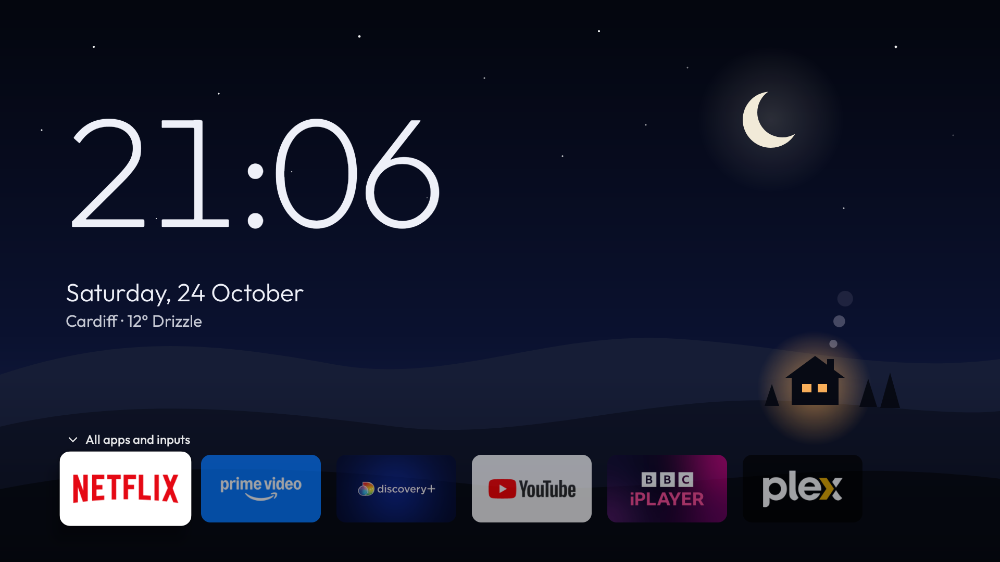
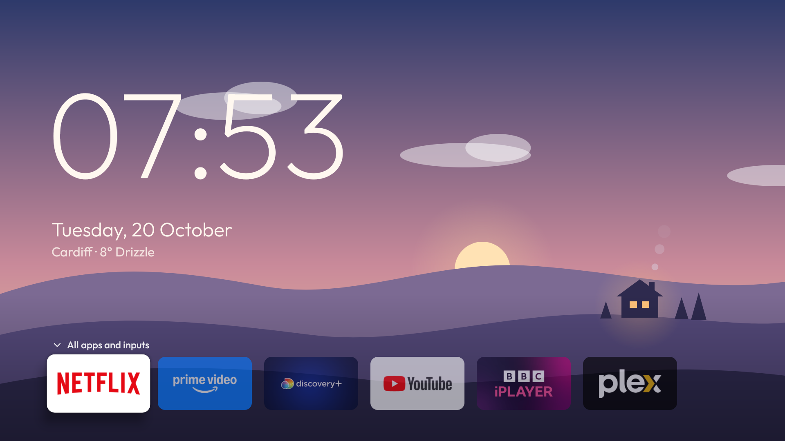
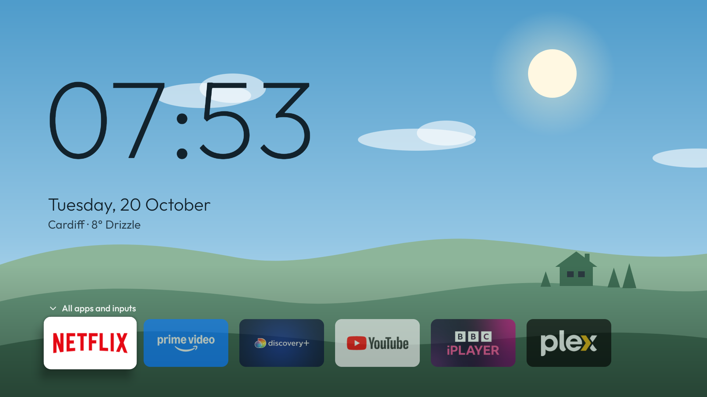
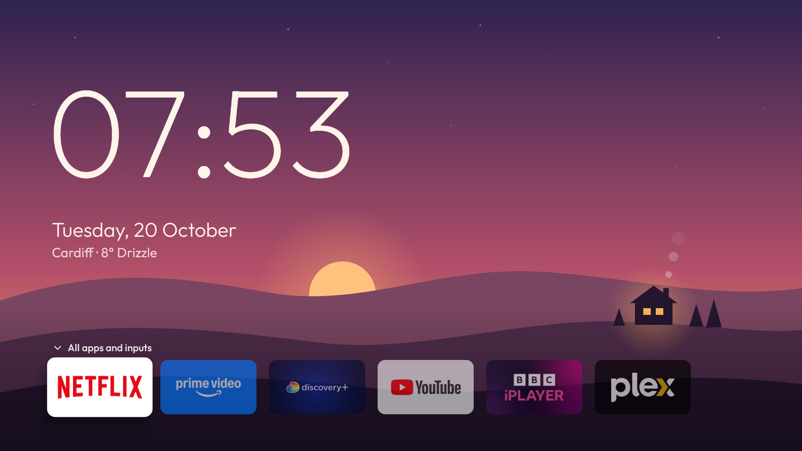

# cozy-firetv

Las dos Fire TV de casa, sin la pantalla de inicio de Amazon.

Un reloj grande sobre un valle que sigue al sol de verdad: las luces de la casita se encienden al
atardecer, de noche salen la luna y las estrellas, y el clima va debajo de la fecha. Abajo hay seis
apps, y con Abajo se abre el panel con todas.



| Amanecer | Día | Atardecer |
|---|---|---|
|  |  |  |

Es un fork de [Cosy Home](https://github.com/oliverjwroberts/cosy-home-tv), de Oliver J. W.
Roberts, que está hecho para un Philips con Android TV. Acá vive adaptado a dos Fire TV Stick, que
es otro mundo: Fire OS no deja reemplazar su launcher, las dos TVs son de generaciones distintas y
cada una toma el botón Home por un mecanismo diferente.

## Lo que cambia respecto de upstream

- **El botón Home.** `HomeButtonService` se come la tecla Home y trae esta app, y vuelve a traerla
  cuando el launcher de Amazon aparece solo. Fire OS protege su launcher y no se puede
  deshabilitar, así que es la única vía.
- **El Appstore como tile.** Es una app de sistema que solo declara `LAUNCHER`, y la grilla
  descarta esas para que no se cuelen Ajustes y el explorador de archivos. Ahora una app de sistema
  nombrada en `dock` o `pinned` pasa igual: nombrarla es el permiso.
- **Las cámaras.** IP Cam Viewer es una app de celular, sin banner y con un ícono diminuto en una
  TV. Tiene arte propia y nombre en castellano.
- **Una config por TV.** Las dos TVs quieren docks distintos, así que un archivo nombrado en la
  línea de comandos se superpone a `cosy.properties`.
- **Los scripts de debloat**, en [`firetv/`](firetv/), para apagar la telemetría y la publicidad
  de Amazon.

## Las dos TVs

| | Principal | LG |
|---|---|---|
| IP | `192.168.100.29` | `192.168.100.15` |
| Modelo | AFTKRT (karat) | AFTMM (mantis) |
| Fire OS | 8.1.8.5 — Android 11 | 6.7.1.1 — Android 7.1 |
| Config | `cosy.properties` | `cosy.lg.properties` |
| Toma Home con | `HomeButtonService` | Launcher Manager |

[`firetv/README.md`](firetv/README.md) tiene el detalle: por qué en Fire OS 6 no se pueden
habilitar servicios de accesibilidad, cómo revivir Launcher Manager después de reinstalar, y qué
archivos hacen falta que **no** están en este repo (la keystore, la clave de ADB, el APK de Flow y
las cámaras cargadas dentro de IP Cam Viewer).

Las dos son de 32 bits: un APK `arm64-v8a` no instala en ninguna.

## Compilar e instalar

Hace falta JDK 17, el Android SDK (plataforma 34 y build-tools 34) y `adb`.

```sh
./gradlew assembleRelease                              # la principal
./gradlew assembleRelease -Pcosy=cosy.lg.properties    # la LG

adb connect 192.168.100.29:5555
adb install -r app/build/outputs/apk/release/app-release.apk
```

La primera vez hay que prender **ADB debugging** en Ajustes → Mi Fire TV → Opciones de
desarrollador, y aceptar en la TV el cartel de autorización.

Después de instalar en la principal, habilitar el servicio de accesibilidad:

```sh
adb shell settings put secure enabled_accessibility_services \
  com.cosyhome.tv/com.cosyhome.tv.HomeButtonService
adb shell settings put secure accessibility_enabled 1
```

En la LG eso no hace falta ni funciona; ahí manda Launcher Manager.

> Un `install -r` encima no molesta a nada. Desinstalar sí: borra el servicio de accesibilidad en
> la principal y deja a Launcher Manager apuntando a nada en la LG. Solo hace falta si cambia la
> firma de la app.

## Las opciones

`cosy.defaults.properties` tiene todas con sus valores por defecto. Los propios van en
`cosy.properties`, y lo que difiera en la segunda TV en `cosy.lg.properties`. Una opción que no
escribas conserva su default. Los nombres de paquete salen de `adb shell pm list packages`.

| Opción | Qué hace |
|---|---|
| `location.name` | El lugar que se muestra antes del clima |
| `location.latitude`, `location.longitude` | Dónde se calculan amanecer, atardecer y clima. Sin esto no hay línea de clima y la escena cambia a horas fijas |
| `dock` | Las apps de la pantalla del reloj, en orden. Entran seis. Las que no estén instaladas se saltean |
| `pinned` | Las que van primero en la grilla después del dock. El resto sigue alfabético. Una app de sistema acá o en `dock` entra a la grilla igual |
| `hidden` | Apps que nunca se muestran |
| `live_tv_package`, `usb_package`, `ambilight_action` | Cosas de TVs Philips. Vacías acá: el Fire TV no tiene nada de eso |

A diferencia de upstream, las dos `cosy.*.properties` **sí** están versionadas: son el registro de
cómo están configuradas estas TVs, que es medio el punto de este fork. La keystore no, nunca.

Para las coordenadas:

```sh
curl "https://geocoding-api.open-meteo.com/v1/search?name=Mar+del+Plata&count=1"
```

## Ver una hora del día

```sh
adb shell am start -n com.cosyhome.tv/.HomeActivity --es phase dusk
```

Las fases son `dawn`, `day`, `dusk` y `night`. `auto` vuelve a seguir al sol.

## Volver al launcher de Amazon

```sh
TV=192.168.100.29 ./firetv/restore.sh     # reactiva todo lo del debloat y devuelve Home
adb uninstall com.cosyhome.tv             # opcional
```

## Traer cambios de upstream

```sh
git remote add upstream https://github.com/oliverjwroberts/cosy-home-tv
git fetch upstream && git merge upstream/main
```

## Qué sale a la red

Un pedido cada 30 minutos a `api.open-meteo.com` con la latitud y longitud redondeadas a dos
decimales, como un kilómetro. Nada más sale de la TV: no hay analytics ni cuentas, y el único
permiso es internet. Sin ubicación configurada no hace ningún pedido.

## Créditos

[Cosy Home](https://github.com/oliverjwroberts/cosy-home-tv), de Oliver J. W. Roberts, que a su vez
salió del launcher de [cleanyourtv](https://github.com/Gathin23/cleanyourtv) de Gathin. Los scripts
de debloat vienen de [firetv-glass-launcher](https://github.com/ivantrj/firetv-glass-launcher) de
ivantrj. Todo MIT; ver `LICENSE`.

- [Outfit](https://github.com/Outfitio/Outfit-Fonts), de The Outfit Project Authors, bajo la SIL
  Open Font License 1.1 (`FONT-LICENSE-OFL.txt`).
- Datos de clima por [Open-Meteo.com](https://open-meteo.com), bajo CC BY 4.0.
